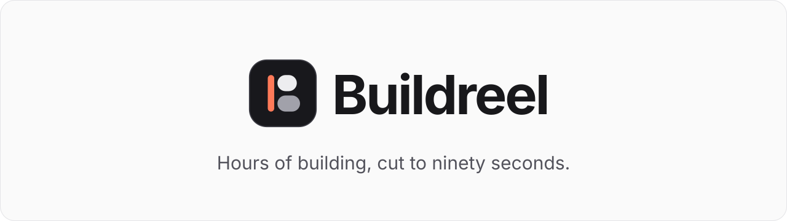
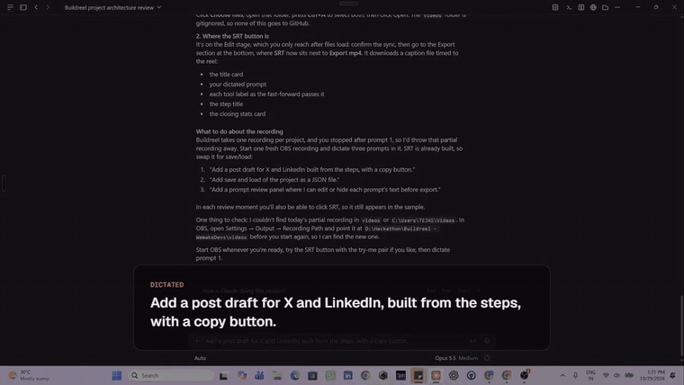
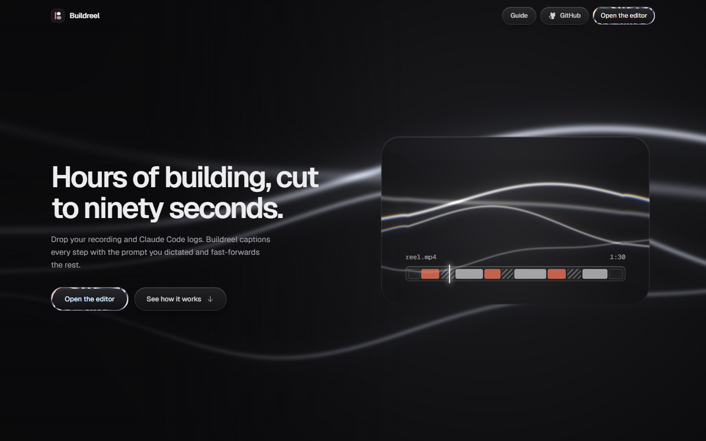
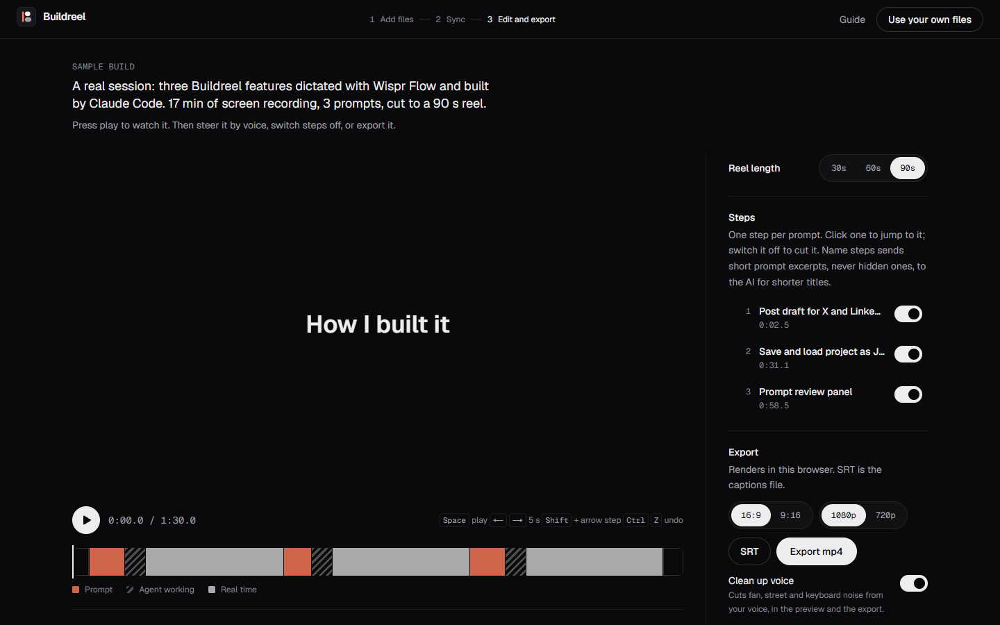
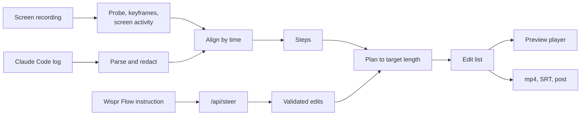

<p align="center">
  <a href="https://buildreel.vercel.app">
    <picture>
      <source media="(prefers-color-scheme: dark)" srcset="docs/media/banner-dark.svg">
      
    </picture>
  </a>
</p>

<p align="center">
  <b>Turn a screen recording of a Claude Code session into a captioned "how I built it" reel.</b><br>
  Dictate your prompts with Wispr Flow. Steer the edit by voice. Export in your browser.
</p>

<p align="center">
  <a href="https://buildreel.vercel.app/editor"></a>
  <a href="https://youtu.be/3c68zmFoClM"></a>
  <a href="https://buildreel.vercel.app/guide"></a>
</p>

<p align="center">
  
  
  
  
  
  
  <a href="LICENSE"></a>
</p>

<p align="center">
  <a href="#what-it-does">What it does</a> ·
  <a href="#how-it-works">How it works</a> ·
  <a href="#quick-start">Quick start</a> ·
  <a href="#use-your-own-build">Use your own build</a> ·
  <a href="#privacy-and-security">Privacy</a> ·
  <a href="ARCHITECTURE.md">Architecture</a>
</p>

<br>

<p align="center">
  
  <br>
  <sub>A real 17 minute session, three features dictated with Wispr Flow, cut to 90 seconds by Buildreel. Full reel: <a href="public/sample/reel.mp4">public/sample/reel.mp4</a></sub>
</p>

---

## Demo video

<p align="center">
  <a href="https://youtu.be/3c68zmFoClM">
    
  </a>
  <br>
  <sub>Two minutes: the problem, the sample build, steering by voice, private prompts, export and the guide. <a href="https://youtu.be/3c68zmFoClM">Watch on YouTube</a></sub>
</p>

## Why

Building with a coding agent is mostly waiting. A good session is an hour of prompts, tool calls and a few moments where something finally works, and nobody wants to watch the hour. Buildreel keeps the parts that tell the story: the prompt you gave, the agent working (fast), and you checking the result. It reads your Claude Code session log to know exactly when each of those happened, so the cut is automatic.

## What it does

| Feature | What it does |
|---|---|
| **Reads your session** | Parses the Claude Code `.jsonl` log for every prompt, tool call and turn, and lines it up with the video by wall-clock time. |
| **Cuts the reel** | Each prompt becomes a step: a card with your prompt, the agent's work fast-forwarded with a chip per tool call, then the most active seconds of you checking the result. It fits 30, 60 or 90 seconds. |
| **Plays your voice** | Finds where you dictated each prompt in the recording and plays it under its card. |
| **Steers by voice** | Hold your Wispr Flow key and say "make it a minute and give step 2 more time". A small model turns that into validated edits, with undo and redo. |
| **Cleans your audio** | RNNoise, running in the browser, removes fan, street and keyboard noise from your voice, in the preview and the export. |
| **Exports anywhere** | An mp4 in 16:9 or vertical 9:16, rendered in your browser with WebCodecs, plus SRT captions and a ready post for X and LinkedIn. |
| **Keeps it private** | The video and log never leave your machine. Keys, tokens, emails and passwords are redacted, and you can edit or hide any prompt before export. |

<table>
  <tr>
    <td width="50%"></td>
    <td width="50%"></td>
  </tr>
  <tr>
    <td align="center"><sub>The landing page</sub></td>
    <td align="center"><sub>The editor, opened on the sample build</sub></td>
  </tr>
</table>

## How it works



1. **Read.** The log is parsed into prompts, tool calls and turn ends, and redacted. The video is probed for its length and keyframes, and its packet sizes give a cheap measure of how much the screen changes every half second.
2. **Align.** The recording's start time comes from the OBS file name, so every log event lands at a moment in the video. You confirm the first prompt once.
3. **Plan.** A deterministic planner turns each prompt into a step and fits all of them to your target length by importance. No network calls are involved, so the reel exists before any AI does anything.
4. **Steer.** A spoken instruction is sent, redacted, to a small model that may only answer with a fixed set of operations (length, keep, drop, emphasise, speed, titles). Each is validated before it changes anything.
5. **Export.** Every output frame is mapped back to its source moment, decoded, drawn with the same overlays as the preview and encoded with WebCodecs. Fast-forwards above 16x decode keyframes only.

The details, including the data model and algorithms, are in [ARCHITECTURE.md](ARCHITECTURE.md).

## Quick start

**Try it now.** Open [buildreel.vercel.app/editor](https://buildreel.vercel.app/editor). It opens a real sample build in about two seconds: press play, switch steps off, say a change into the steer box, export.

**Run it locally.** Requires Node 20 or newer, and a recent Chrome or Edge for export.

```bash
git clone https://github.com/TejasThange3/buildreel.git
cd buildreel
npm install
cp .env.example .env.local
npm run dev
```

Open http://localhost:3000. Everything works with no keys except the two small model calls: steering and step names need `LLM_API_KEY` in `.env.local` (any OpenAI-compatible endpoint; the example uses Groq's free tier).

| Variable | Needed for |
|---|---|
| `LLM_API_KEY`, `LLM_BASE_URL`, `LLM_MODEL` | Steering by voice and naming steps |
| `UPSTASH_REDIS_REST_URL`, `UPSTASH_REDIS_REST_TOKEN` | Rate limits. Without them `npm run dev` runs unlimited, and a production build refuses model calls rather than spend without a cap |

## Use your own build

1. **Record while you build.** Start OBS (or any recorder that saves MP4 or MKV) before your first prompt. Dictate each prompt with Wispr Flow, and after each one, try the result on screen for a few seconds.
2. **Find your two files.** The recording is in your Videos folder. The log is the newest `.jsonl` in your project's folder under `%USERPROFILE%\.claude\projects` on Windows or `~/.claude/projects` on macOS and Linux.
3. **Add them.** Open the editor, press **Use your own files**, add the recording, then the log.
4. **Line them up.** Check that your first prompt appears where Buildreel says it does, then press **Looks right**.

The full walkthrough is at [buildreel.vercel.app/guide](https://buildreel.vercel.app/guide).

## Privacy and security

- **Local first.** Decoding, planning, audio cleanup and encoding all run in your browser. The recording and the log are never uploaded.
- **Redacted text only.** The server only sees your spoken instruction, step titles, and (when you press Name steps) short prompt excerpts, all redacted first. Hidden prompts are never sent, and nothing from a request is logged.
- **Your words, your call.** Edit or hide any prompt card before export. Editing a card mutes its voice clip, and dictation is never heard outside its own card.
- **Hardened routes.** Model output is limited to a fixed schema and checked against the real steps. Requests are capped at 200 KB, rate limited per visitor and per day, and refused in production if the limiter is not configured.

## Tech stack

| Layer | Tools |
|---|---|
| App | Next.js 16 (App Router), React 19, TypeScript (strict), Tailwind CSS 4, zustand, zod |
| Video | Mediabunny for demux, decode, encode and mux over WebCodecs |
| Audio | RNNoise compiled to WebAssembly, for noise removal and voice detection |
| AI | Groq (`openai/gpt-oss-20b`) through an OpenAI-compatible API, with strict JSON schemas |
| Platform | Vercel for hosting, Upstash Redis for rate limits |
| Visuals | Paper Shaders for the liquid metal and glass on the landing page |
| Tests | Vitest, with fixtures trimmed from real Claude Code sessions |

## Project structure

```
src/
  app/          routes: landing, editor, guide, /api/steer, /api/titles
  lib/          pure logic: log parsing and redaction, media, timeline, planning, rendering, audio
  server/       server only: model calls, rate limits, request handling
  shared/       types and zod schemas shared by browser and server
  state/        the project store, sample loading, API clients
  ui/           editor, guide and landing components
tests/          unit tests for the pure functions
public/sample/  the sample build: recording, trimmed log, project, analysis and reel
```

## Development

```bash
npm test            # Vitest
npm run typecheck   # tsc, strict
npm run lint        # ESLint
npm run build       # production build
```

## License

[MIT](LICENSE) © 2026 Tejas Thange

<p align="center"><sub>Buildreel. Hours of building, cut to ninety seconds.</sub></p>
